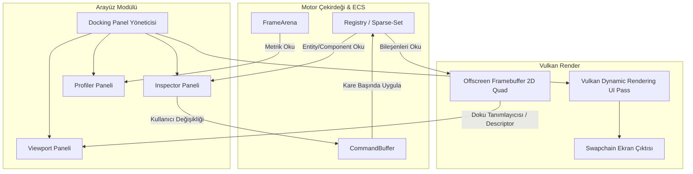

# PROJECT-EMBER: Motor ve Editör Panel Tasarım Mimarisi

Bu belge, motorun görsel panel düzenini, veri akışını ve arayüz mimarisini tanımlar.

---

## 1. Temel İlke: Bağımsız Offscreen Viewport

Geleneksel amatör motorlarda oyun sahnesi doğrudan pencereye (swapchain) çizilir ve üzerine arayüz bindirilir. Bu yaklaşım şu sorunları doğurur:
- Pencere boyutu değiştikçe oyunun en-boy oranı (aspect ratio) bozulur.
- Editör pencerelerine tıklarken alttaki oyuna girdi sızar (input leaking).
- Render döngüsü arayüz döngüsüne düğümlenir.

**EMBER Mimarisi:**
1. **Oyun Render'ı:** Oyun sahnesi (50k-200k sprite) bağımsız bir **Offscreen Texture (FrameBuffer)** içine çizilir. Bu dokunun çözünürlüğü sabittir (örneğin 1920x1080 veya pencereye göre dinamik ölçekli).
2. **Editör Render'ı:** Editör arayüzü (`egui` veya `imgui-rs`), swapchain üzerine tam ekran bir dockspace olarak çizilir.
3. **Viewport Paneli:** Editördeki "Viewport" paneli, bu offscreen dokuyu bir görsel kutusu (Image widget) olarak ekrana basar.

---

## 2. Panel Düzeni ve Ekran Yerleşimi (Docking Layout)

```
+---------------------------------------------------------------------------------------+
| [Menü Çubuğu]: Dosya | Düzenle | Sahne | Varlıklar | Pencereler | Yardım | [Oynat/Durdur] |
+-----------------------+-----------------------------------------------+---------------+
| HİYERARŞİ (Hierarchy) | VIEWPORT (Oyun Sahnesi - Offscreen Texture)   | DENETÇİ       |
|                       |                                               | (Inspector)   |
| - Sahne Kökü          |                                               |               |
|   +-- Kamera          |  [ 2D Oyun Alanı: 50.000 Sprite Simülasyonu ] | Transform:    |
|   +-- Oyuncu          |                                               |   X: 120.0    |
|   +-- Mermi Havuzu    |                                               |   Y: 340.5    |
|   +-- Işık / Efekt    |                                               |               |
|                       |                                               | Sprite:       |
|                       |                                               |   Texture: 2  |
|                       |                                               |   Renk: Red   |
|                       +-----------------------------------------------+               |
|                       | TEŞHİS VE PROFİLER (Diagnostics)              | Velocity:     |
|                       | Kare Bütçesi: [====== 41.5% ======| 16.6 ms ] |   Vx: 15.0    |
|                       | CPU ECS: 0.12 ms | GPU: 6.92 ms | Entity: 50k |   Vy: -4.2    |
+-----------------------+-----------------------------------------------+---------------+
| KONSOL / GÜNLÜK (Console & Logs)              | VARLIK TARAYICI (Asset Browser)       |
| [INFO] Vulkan 1.3 RADV Discrete GPU seçildi.  | > textures/                           |
| [WARN] Mermi havuzu %80 doluluğa ulaştı.      |   +-- bullet.png                      |
| [OK] FrameArena 64MB temizlendi.              |   +-- ship.png                        |
+-----------------------------------------------+---------------------------------------+
```

---

## 3. Sekmelerin ve Panellerin Teknik Görevleri

### A. Viewport (Sahne Görünümü)
- Yalnızca bir görüntüleme penceresidir.
- Farenin Viewport paneli üzerindeki koordinatları (Screen Space), oyunun dünya koordinatlarına (World Space) dönüştürülür.
- Farenin odağı Viewport'ta değilse (örneğin Inspector'da bir sayı değiştiriliyorsa), oyuna klavye/fare girdisi gönderilmez.

### B. Inspector (Özellik Denetçisi)
- Hiyerarşiden seçilen bir `Entity`'nin bileşenlerini listeler.
- Bileşen değerleri doğrudan belleğe yazılmaz! Değişiklikler **`CommandBuffer`** üzerinden kuyruğa alınır ve bir sonraki kare başında güvenli şekilde uygulanır (Data race ve borrow hatasını önler).

### C. Profiler & Diagnostics (Performans Paneli)
- **Kare Bütçesi Çubuğu:** 16.66 ms (60 FPS) veya 6.94 ms (144 FPS) sınırının yüzde kaçının kullanıldığını gösterir.
- **Havuz Dolulukları:** Flat sparse-set dense dizisi boyutu, geri dönüştürülen entity ID sayısı.
- **Arena Metriği:** 64MB sanal bellek alanının kaç baytının tüketildiği (örneğin `1.42 MB / 64 MB`).

### D. Console & Logs (Kayıt Defteri)
- Çekirdek motor, Vulkan validasyon katmanı ve script çalışma zamanı loglarını filtreli olarak gösterir (Hata, Uyarı, Bilgi).

---

## 4. UI ile Motor Çekirdeği Arasındaki Veri Akışı



---

## 5. Uygulama Stratejisi (2 Aşamalı Geçiş)

1. **Aşama 2 (Hemen / Şimdi): Dahili Teşhis Katmanı (In-Game Overlay)**
   - Tam bir docking sistemi yerine ekranın sağ üstüne ve altına şeffaf sekmeli paneller (HUD).
   - Profiler, Entity sayısı, VRAM durumu ve mermi kontrolleri.
   - Bu sayede 20.000 mermili simülasyonu çalıştırırken anında görsel kontrol sağlanır.

2. **Aşama 8 (Planlanan Nihai Editör): Bağımsız Docking Editör (`rugeng_editor`)**
   - `egui` veya `imgui` Vulkan backend'i ile tam ekran docking, pencerelerin taşınması, ayrı pencerelere ayrılabilmesi (multi-viewport) ve sahne kaydetme/yükleme.
